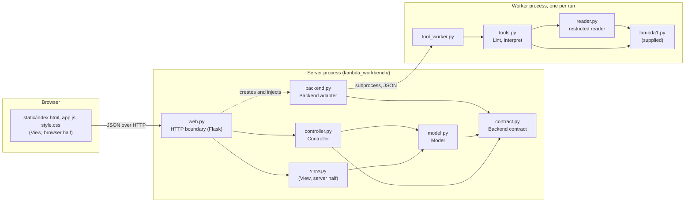

# Architecture: LAMBDA workbench

The application is a local, single-user web front-end for the LAMBDA language
tools. It follows Model–View–Controller, with the language tools kept behind a
separate backend adapter.

## 1. Components and dependencies

An arrow means "imports" (Python) or "sends requests to" (browser to server).



The model, controller and view never import `backend.py`, `reader.py`,
`tools.py` or `lambda1.py`. The controller is given a backend object when it is
constructed and knows it only through the `Backend` protocol in `contract.py`.
Only `web.py` imports Flask, and only `backend.py` starts processes. These
rules are checked automatically by `tests/test_architecture.py`.

## 2. Responsibilities

| Role | Where | Responsibility |
| --- | --- | --- |
| Model | `model.py`: `Workbench`, `Snapshot`, `Result`, `Ticket`, `decode_upload` | Owns the applied source and its revision, the editor draft, results for the current revision, the generated-code artifact and the busy flag. Enforces every state rule: source validation (empty, size, UTF-8), revision increments, clearing results and artifacts, blocking while busy or while edits are unapplied, and when Execute is available. |
| View, server half | `view.py`: `render_state`, `outcome_label`, `ACTIONS` | Turns a model snapshot into the description the page draws: button order and labels, outcome labels, enabled flags and reasons. |
| View, browser half | `static/index.html`, `app.js`, `style.css` | Draws the source menu, editor, buttons, status line and results. Forwards user actions as requests. Places all source and output with `textContent`. |
| Controller | `controller.py`: `WorkbenchController`, `Reply` | Handles source changes and action requests. Asks the model for permission, calls the backend, returns the output to the model, and replies with the snapshot to present. |
| HTTP boundary | `web.py`: `create_app` | Unpacks each request, makes one controller call, returns the view's rendering. No rules and no language logic. |
| Backend contract | `contract.py`: `Backend`, `Operation`, `Outcome`, `ToolOutput`, `Artifact` | The types every backend must use. No dependencies. |
| Backend adapter | `backend.py`: `LambdaBackend` | Implements the five operations. Runs Lint and Interpret in a worker process with a time bound. |
| Language tools | `tools.py`, `reader.py`, `tool_worker.py`, `lambda1.py` | Read constructor text into a `d0exp`, compute free variables, evaluate. |

## 3. Backend contract

```text
lint(source: str)                  -> ToolOutput
interpret(source: str)             -> ToolOutput
typecheck(source: str)             -> ToolOutput   (currently NOT_IMPLEMENTED)
compile(source: str)               -> ToolOutput   (currently NOT_IMPLEMENTED)
execute(artifact: Artifact | None) -> ToolOutput   (currently NOT_IMPLEMENTED)

ToolOutput(outcome: Outcome, text: str, artifact: Artifact | None = None)
Artifact(revision: int, language: str, code: str)
```

| Outcome | Meaning | Shown as |
| --- | --- | --- |
| `SUCCESS` | The tool finished and accepted the program. | Success |
| `INPUT_ERROR` | The text is not a valid constructor expression. | Input error |
| `LANGUAGE_ERROR` | The expression is valid but the language rejects it: undeclared variables, or a failure while running. | Lint error / Runtime error |
| `TIMEOUT` | The tool exceeded its time bound and was stopped. | Timed out |
| `BACKEND_FAILURE` | The tool itself failed. Not a problem in the program. | Backend failure |
| `NOT_IMPLEMENTED` | The operation is a placeholder. | Not implemented |

A backend does not know about revisions. The model stamps each output with the
operation and revision of the `Ticket` it issued, producing a
`Result(operation, revision, outcome, text)`. A backend must return within a
bounded time, must not raise for errors in the program, and must not evaluate
during `lint`. If a backend does raise or returns something that is not a
`ToolOutput`, the controller records a `BACKEND_FAILURE` result.

Only a successful `compile` may return an artifact. `execute` receives that
stored artifact and must not recompile or interpret the source.

## 4. Trace: Load source → Lint → Interpret

The user loads `examples/undeclared-variable.lambda`, which contains
`D0Eop2("+", D0Evar("x"), D0Eint(1))`.

1. **Load.** The browser posts the file to `/api/source/upload`. `web.py` calls
   `controller.upload(name, bytes, editor_text)`.
2. The controller records the editor text with `model.edit`, decodes the bytes
   with `decode_upload`, and calls `model.load(name, text)`.
3. The model checks that it is idle and has no unapplied edits, validates the
   text, sets the revision to 1, and clears results and any artifact.
4. `view.render_state` describes the new snapshot. The page shows "Applied
   source: undeclared-variable.lambda, revision 1" and enables the four source
   buttons.
5. **Lint.** The browser posts to `/api/actions/lint`. The controller calls
   `model.begin(LINT)`, which marks the model busy and returns a
   `Ticket(LINT, revision 1, source)`.
6. The controller calls `backend.lint(source)`. The adapter starts a worker,
   which reads the text into a `d0exp` and calls `d0exp_fvset`. Nothing is
   evaluated. The set is `{"x"}`, so the output is
   `ToolOutput(LANGUAGE_ERROR, "Undeclared variable(s): x")`.
7. The controller calls `model.finish(ticket, output)`. The model stores
   `Result(LINT, 1, LANGUAGE_ERROR, ...)` and clears the busy flag.
8. The page shows "Lint · revision 1 · Lint error" and the message. The source
   is unchanged and all controls are available again.
9. **Interpret.** Lint does not gate Interpret, so the user may run it anyway.
   The same steps run with `backend.interpret`. The worker calls
   `d0exp_evaluate` with the empty environment. Looking up `x` yields the error
   value `D0V000()`, and adding it to an integer raises `TypeError`, which the
   tool reports as `ToolOutput(LANGUAGE_ERROR, "Runtime error: TypeError ...")`.
10. The page shows "Interpret · revision 1 · Runtime error" above the Lint
    result. Both results carry revision 1.

If the user then edits the source to `D0Elam("x", D0Evar("x"))` and applies it,
the model creates revision 2 and clears both results; Lint then reports
"No free variables found."

## 5. Design decisions

**The controller coordinates backend calls; the model never calls a backend.**
The model hands out a `Ticket` in `begin` and takes the output back in
`finish`. The slow call happens in the controller, between the two, outside
the model's lock.

- Gained: the model is pure state and can be tested with no backend and no
  threads. Other requests can still read the state while a tool runs.
- Cost: an operation is split across two model calls, so the controller must
  always call `finish`, even when the backend fails. A controller that forgot
  would leave the workbench busy. This is covered by a `try`/`except` around
  the dispatch and by tests that inject a failing backend.

**The model lives on the server and decides whether edits are unapplied.**
Every request carries the current editor text. The model compares it with the
text the editor started from and refuses tool actions and source replacement
if they differ.

- Gained: the rule holds for any client and can be tested without a browser.
  State survives a page reload.
- Cost: the browser must keep the buttons current while the user types,
  between requests. `app.js` therefore repeats one comparison
  (`editor.value !== state.editor.base`). This is a second copy of the check,
  used only for display; the server's answer is the one that counts. Sending
  every keystroke to the server would remove the copy but add a request per
  keystroke.

A third, smaller decision: each Lint or Interpret run starts a new worker
process. Starting a process costs tens of milliseconds per run, but a process
is the only unit that can be reliably stopped when a program does not
terminate.

## 6. Replacing the placeholders

**Type-check.** Implement a tool function next to `lint_source` in `tools.py`
that reads the expression and returns `SUCCESS` or `LANGUAGE_ERROR`, register
it in `tool_worker.py`, and change `LambdaBackend.typecheck` to call
`_run_worker`. Nothing in the model, controller or view changes.

**Compile.** Do the same for `compile`, and return the generated code as
`ToolOutput(SUCCESS, text, Artifact(0, language, code))`. The model already
handles the rest: on a successful Compile it stores the artifact stamped with
the ticket's revision, and on any other Compile outcome it removes the stored
artifact.

**Execute.** Once an artifact exists for the current revision, the model
reports Execute as available, the view enables the button, and the controller
passes the stored artifact to `backend.execute`. `LambdaBackend.execute` would
run the generated code in a worker with the same time bound. It receives only
the artifact, so it cannot silently recompile. Any accepted source change
clears the artifact, which disables Execute again.

This artifact handling is implemented and tested in the model and controller
with a test backend. It is an extension beyond the required functionality: no
real compiler is connected, so in the running application Execute is always
disabled.
